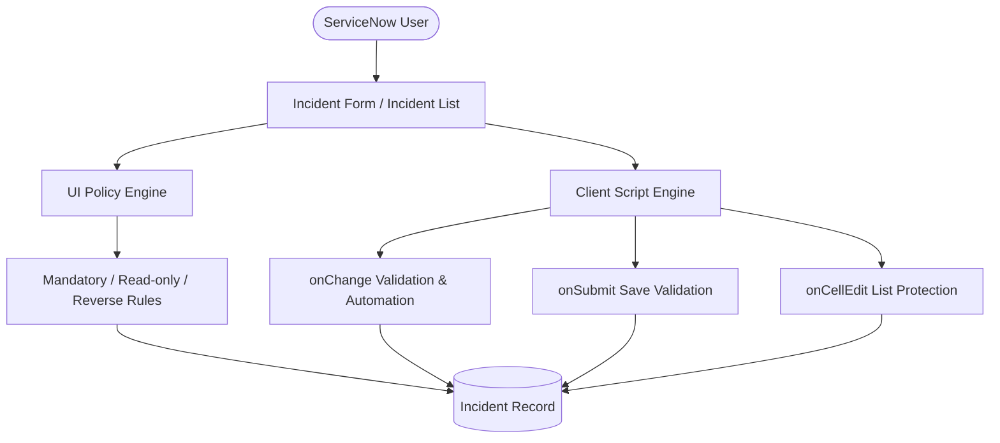
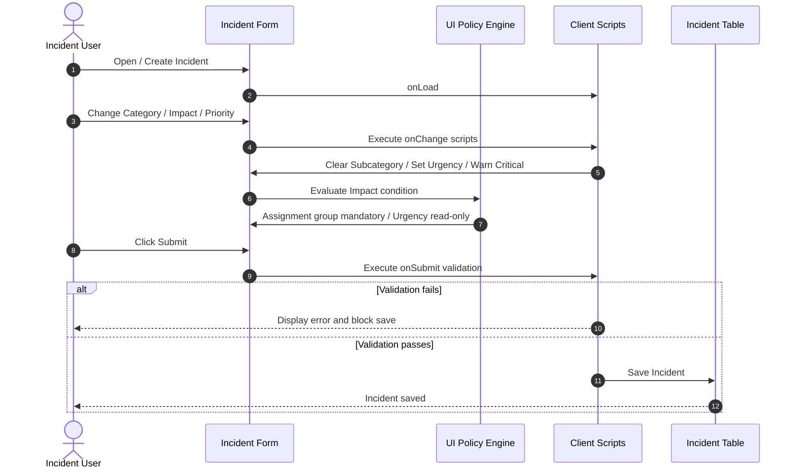

# Implement Client Script & UI Policy (Incident)

[](https://www.servicenow.com)
[](https://developer.servicenow.com)
[](https://docs.servicenow.com)
[](#)

## Executive Summary

The **Implement Client Script & UI Policy (Incident)** project demonstrates how ServiceNow client-side controls improve data quality and user interaction on Incident records. UI Policies control conditional field behavior, while Client Scripts provide dynamic validation, automatic updates, warnings and list-edit protection.

The core policy is **High Impact Control**. When `Impact = 1 - High`, `Assignment group` becomes mandatory and `Urgency` becomes read-only. An Impact onChange Client Script automatically sets Urgency to High. Additional client-side rules validate Short description on submit, clear Subcategory when Category changes, warn when Priority is Critical, prevent saving a High-impact Incident without Assigned To, and prevent direct State changes from the Incident list.

## Project Team

| Name | Role | Core Responsibility |
| :--- | :--- | :--- |
| **Rahul** | **Team Lead** | Architecture, project coordination, GitHub submission |
| **Dinesh Kumar** | **Member** | UI Policies and UI Policy Actions |
| **Abisheknathan** | **Member** | Client Scripts |
| **Dakshanraj** | **Member** | UAT testing, validation and final report |

## Key Objectives

1. Validate the Short description on submit (client-side).
2. Clear Subcategory when Category changes.
3. Warn the user when Priority is set to 1 - Critical.
4. Make Assignment group mandatory when Impact is 1 - High.
5. Make Urgency read-only when Impact is 1 - High.
6. Automatically set Urgency to High when Impact is High.
7. Prevent saving a High-impact Incident when Assigned To is empty.
8. Prevent direct State updates through list editing.
9. Allow State changes through the Incident form.
10. Verify Reverse if false behavior when Impact changes away from High.

## Architecture & Workflow

### 1. High-Level System Architecture



### 2. End-to-End Sequence Diagram



## Project Structure

```text
Implement-Client-Script-&-UI-Policy-Incident/
├── README.md
├── 01_phase1_ideation/
├── 02_phase2_requirements/
├── 03_phase3_project_design/
├── 04_phase4_project_planning/
├── 05_phase5_development_and_testing/
├── 06_phase6_project_documentation/
├── service_now_artifacts/
├── automated_tests/
├── docs/
├── live_execution_proofs/
└── phasewise_deliverables_docx_and_pdf/
```

## Six Milestones & Implementation Details

### Milestone 1: Problem Definition and Ideation
Identify Incident data-quality issues and define the scope of client-side controls.

### Milestone 2: Requirements Analysis
Translate the business rules into UI Policy and Client Script requirements.

### Milestone 3: Architecture and Design
Define the Incident form workflow, event types, policy conditions and validation flow.

### Milestone 4: ServiceNow Implementation
Configure High Impact Control and implement onLoad, onChange, onSubmit and onCellEdit scripts.

### Milestone 5: Testing and Verification
Run positive and negative UAT scenarios and execute the repository verification suite.

### Milestone 6: Documentation and Submission
Prepare phasewise documentation, formatted PDF/DOCX deliverables and the GitHub-ready package.

## Business Impact & Results

| Area | Expected Result |
| :--- | :--- |
| Data quality | More complete and consistent Incident records |
| High-impact routing | Assignment group enforced when Impact is High |
| Field control | Urgency becomes read-only when Impact is High |
| Automation | Urgency automatically set to High |
| Dependent data | Subcategory cleared when Category changes |
| User guidance | Critical Priority warning displayed immediately |
| Save protection | Invalid high-impact submissions blocked |
| List protection | State list edits blocked |

## Project Documentation & Phasewise Deliverables

The repository contains all six lifecycle phases, implementation artifacts, UAT documentation, a Functional Specification Document, final report, formatted PDF/DOCX deliverables and automated verification.

## Automated Verification

Run:

```bash
python automated_tests/test_incident_project.py
```

The local verification suite checks the project artifacts and simulates the configured Incident rules. It is supplementary to live testing in a ServiceNow instance.
